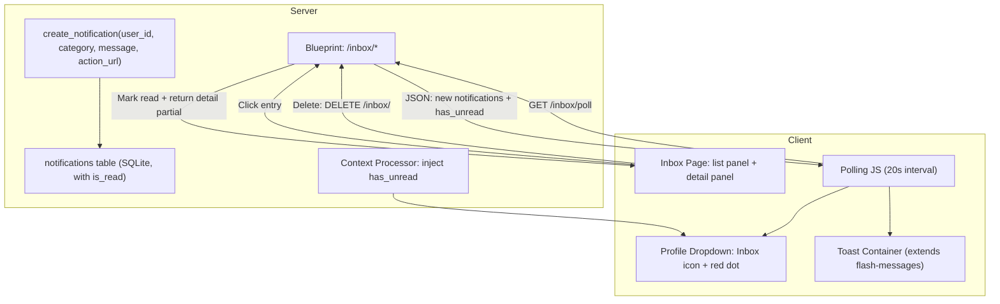
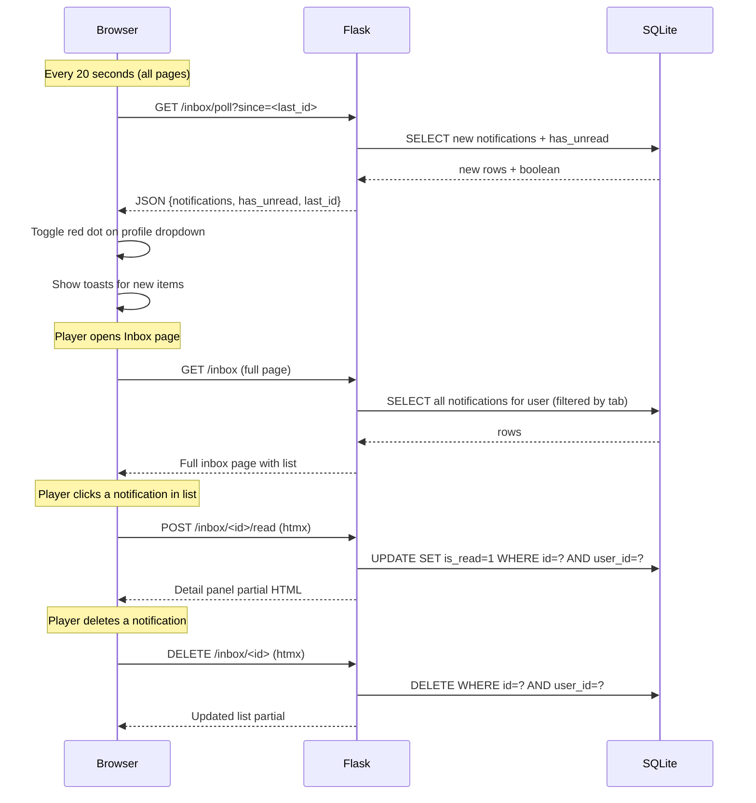

# Design Document: Notification System

## Overview

The Notification System is shared infrastructure for OreX that provides a single entry point (`create_notification`) for any game feature to emit in-app notifications. It manages the full lifecycle: storage in SQLite, a full Inbox page with two-panel layout (list + detail), category-aware toast popups via JS polling, and a red unread indicator dot in the profile dropdown.

The system extends the existing flash/toast infrastructure rather than building a parallel mechanism. Flash messages (success/error) remain for synchronous user actions; notifications handle asynchronous, persistent events generated by other game systems (achievements, liquidations, market events, daily bonuses, etc.).

### Design Decisions

| Decision | Rationale |
|----------|-----------|
| Keep `is_read` column | Notifications persist and are visually distinguished (bold vs greyed). Users manually delete when ready. |
| No auto-pruning | Users control their own inbox. Delete is per-item via a bin icon on hover. |
| Full Inbox page (not a dropdown tray) | Allows richer detail panels per notification, filter tabs, and a layout that scales better with volume. |
| Red dot (no count) in profile dropdown | Simpler indicator. Polling every 20s just toggles a dot — no badge math needed. |
| 20-second polling for dot + toasts | Lightweight check. Matches the existing market tick cadence. Toasts still fire on new notifications. |
| Profile dropdown redesign | Compact icon-row layout for quick access to Portfolio, Inbox, History. Text links for Profile, Settings. Logout separated at bottom. |
| Category as free-form TEXT | New features can emit any category string without schema migrations. Toast styling falls back to a default for unknown categories. |
| Detail panel is template-based | Each category can have its own expanded view. Simple notifications get a generic "email-like" layout; complex ones (badges, trades) can pull additional context. |

## Architecture



### Request Flow



## Components and Interfaces

### 1. Data Layer (`app/models.py` additions)

| Function | Signature | Description |
|----------|-----------|-------------|
| `create_notification` | `(user_id, category, message, action_url=None) -> int` | Validates inputs, inserts new row (is_read=0), returns ID |
| `get_notifications` | `(user_id, filter='all') -> list[Row]` | Returns notifications filtered by 'all', 'read', or 'unread', newest first |
| `get_notification_detail` | `(notification_id, user_id) -> Row or None` | Returns a single notification owned by user |
| `has_unread_notifications` | `(user_id) -> bool` | Returns True if any is_read=0 notifications exist |
| `get_new_notifications_since` | `(user_id, since_id) -> list[Row]` | Returns unread notifications with id > since_id (for polling/toasts) |
| `mark_notification_read` | `(notification_id, user_id) -> bool` | Sets is_read=1 for a single notification owned by user |
| `mark_all_notifications_read` | `(user_id) -> int` | Sets is_read=1 for all notifications for user; returns updated count |
| `delete_notification` | `(notification_id, user_id) -> bool` | Deletes a single notification owned by user; returns success |

### 2. Blueprint (`app/routes/inbox.py`)

| Endpoint | Method | Purpose | Response |
|----------|--------|---------|----------|
| `/inbox` | GET | Full inbox page | Full HTML page with list + empty detail panel |
| `/inbox/poll` | GET | Polling endpoint for dot + toasts | JSON `{notifications: [...], has_unread: bool, last_id: int}` |
| `/inbox/<id>` | GET | Load detail panel for a notification | HTML partial (detail panel content) |
| `/inbox/<id>/read` | POST | Mark notification as read + return detail | HTML partial (detail panel) |
| `/inbox/<id>` | DELETE | Delete a notification | HTML partial (updated list) or 204 |
| `/inbox/mark-all-read` | POST | Mark all notifications as read | HTML partial (updated list) or redirect |

All endpoints require `@login_required`. The blueprint uses `url_prefix='/inbox'`.

### 3. Context Processor

Registered in `create_app()`, injects `has_unread` (boolean) into all templates for authenticated users. Uses `has_unread_notifications(current_user.id)`.

### 4. Templates

| Template | Purpose |
|----------|---------|
| `partials/nav.html` (modification) | Redesign profile dropdown: icon row (Portfolio, Inbox, History) + text links + red dot on Inbox icon |
| `inbox.html` (new) | Full inbox page with two-panel layout |
| `partials/inbox_list.html` (new) | Left panel: notification list with filter tabs |
| `partials/inbox_detail.html` (new) | Right panel: expanded notification detail |
| `partials/notification_toast.html` (new) | Single toast template for JS injection |

### 5. Client-Side (`static/js/notifications.js` extension)

The existing `notifications.js` handles flash toasts on page load. The extension adds:
- **Polling loop**: `setInterval` at 20s, `fetch('/inbox/poll?since=<last_id>')`
- **Red dot toggle**: Adds/removes `.has-unread` class on the inbox icon in the profile dropdown
- **Toast injection**: Creates toast DOM elements matching the existing `.flash--toast` structure, with category-specific modifiers
- **Inbox page interactivity** (when on inbox page): List click → load detail, hover → show bin icon, delete → remove from list

### 6. CSS (`static/css/global.css` additions)

New/modified classes:
- `.flash--achievement` — yellow background, trophy icon (already exists)
- `.flash--liquidation` — red background, warning icon
- `.nav__dropdown-icons` — icon row container in profile dropdown
- `.nav__dropdown-icon` — individual icon button in dropdown
- `.nav__dropdown-icon--unread` — red dot indicator on inbox icon
- `.inbox` — two-panel page layout
- `.inbox__list` — left panel styles
- `.inbox__list-item` — notification row (bold when unread, greyed when read)
- `.inbox__list-item:hover .inbox__delete-btn` — bin icon visibility on hover
- `.inbox__detail` — right panel styles
- `.inbox__filters` — filter tab row (All | Read | Unread)

### 7. Profile Dropdown Redesign

The existing dropdown has text-only links. The new design:

```
┌─────────────────────────┐
│  [📁] [📥•] [🕐]       │  ← Icon row (Portfolio, Inbox w/ dot, History)
├─────────────────────────┤
│  Profile                │
│  Settings               │
├─────────────────────────┤
│  Logout                 │  ← Red text, separated
└─────────────────────────┘
```

- Icons use Material Design icons (placeholder emojis above)
- Red dot overlays the Inbox icon when `has_unread` is true
- Icon clicks navigate directly to the respective pages
- Text links remain for Profile and Settings

## Data Models

### Notifications Table

```sql
CREATE TABLE IF NOT EXISTS notifications (
    id INTEGER PRIMARY KEY,
    user_id INTEGER NOT NULL,
    category TEXT NOT NULL,
    message TEXT NOT NULL,
    action_url TEXT,
    is_read INTEGER NOT NULL DEFAULT 0,
    created_at TEXT NOT NULL DEFAULT (datetime('now', 'localtime')),
    FOREIGN KEY (user_id) REFERENCES users(id) ON DELETE CASCADE
);

CREATE INDEX IF NOT EXISTS idx_notifications_user_read
    ON notifications(user_id, is_read);
CREATE INDEX IF NOT EXISTS idx_notifications_user_id_desc
    ON notifications(user_id, id DESC);
```

**Notes:**
- `is_read` column retained — read notifications appear greyed in the inbox list.
- No auto-pruning — users delete notifications manually.
- `ON DELETE CASCADE` handles account deletion automatically.
- `idx_notifications_user_read` supports efficient unread checks and filtered queries.
- `idx_notifications_user_id_desc` supports efficient polling queries (`WHERE user_id = ? AND id > ?`).

### Account Lifecycle Changes

In `reset_account()` (models.py), add:
```python
db.execute("DELETE FROM notifications WHERE user_id = ?", (user_id,))
```

In `delete_account()`, the CASCADE foreign key handles cleanup automatically.

## Correctness Properties

### Property 1: Notification creation round-trip

*For any* valid user ID, any non-empty category string, and any non-whitespace message string, calling `create_notification(user_id, category, message, action_url)` SHALL return a positive integer ID, and retrieving the notification by that ID SHALL yield a record with matching user_id, category, message, action_url, is_read=0, and a non-null created_at timestamp.

**Validates: Requirements 2.1, 2.2, 1.5, 2.5**

### Property 2: Whitespace message rejection

*For any* string composed entirely of whitespace characters (including the empty string), calling `create_notification` with that string as the message SHALL raise a `ValueError`, and the total notification count for the user SHALL remain unchanged.

**Validates: Requirements 2.3**

### Property 3: Non-existent user rejection

*For any* integer user_id that does not correspond to an existing user in the database, calling `create_notification` with that user_id SHALL raise a `ValueError` and no notification record SHALL be inserted.

**Validates: Requirements 2.4**

### Property 4: Has-unread accuracy

*For any* user with at least one notification where is_read=0, `has_unread_notifications(user_id)` SHALL return True. For any user with all notifications marked is_read=1 (or no notifications), it SHALL return False.

**Validates: Requirements 3.2**

### Property 5: List ordering is newest-first

*For any* user with multiple notifications, `get_notifications(user_id)` SHALL return them in strictly descending order of `id` (newest first), regardless of filter.

**Validates: Requirements 4.1**

### Property 6: Mark-all-read marks all notifications

*For any* user with one or more unread notifications, calling `mark_all_notifications_read(user_id)` SHALL result in `has_unread_notifications(user_id)` returning False, and all notifications having is_read=1.

**Validates: Requirements 4.5**

### Property 7: Category style mapping is deterministic and consistent

*For any* category string, the style mapping function SHALL return identical (css_class, icon, duration) values regardless of the notification's message, action_url, or creation time.

**Validates: Requirements 9.3, 9.4, 9.5**

### Property 8: Watermark filtering returns only newer unread notifications

*For any* user with notifications and any valid `since_id`, calling `get_new_notifications_since(user_id, since_id)` SHALL return only unread notifications whose `id` is strictly greater than `since_id`, and SHALL return all such notifications for that user.

**Validates: Requirements 6.5**

### Property 9: Single delete removes exactly one notification

*For any* notification belonging to a user, calling `delete_notification(notification_id, user_id)` SHALL delete that specific notification and leave all other notifications for that user unchanged.

**Validates: Requirements 8.1**

### Property 10: Mark-read sets is_read without deleting

*For any* unread notification, calling `mark_notification_read(notification_id, user_id)` SHALL set is_read=1 and the notification SHALL still be retrievable. The total notification count SHALL remain unchanged.

**Validates: Requirements 4.3, 4.4**

### Property 11: Account reset removes all notifications

*For any* user with notifications, calling `reset_account(user_id)` SHALL result in zero notifications remaining for that user in the database.

**Validates: Requirements 10.1**

## Error Handling

| Scenario | Handling |
|----------|----------|
| `create_notification` with whitespace-only message | Raise `ValueError("Message cannot be empty or whitespace-only")` |
| `create_notification` with non-existent user_id | Raise `ValueError("User does not exist")` |
| `delete_notification` with ID not belonging to user | Return `False`; no deletion occurs (prevents cross-user manipulation) |
| `delete_notification` with non-existent ID | Return `False`; no-op |
| `mark_notification_read` with ID not belonging to user | Return `False`; no update occurs |
| Poll endpoint called by unauthenticated user | Return 401 / redirect to login (Flask-Login handles this via `@login_required`) |
| Poll endpoint with invalid `since` parameter | Default to `since=0` (return all unread) |
| Database error during notification creation | Let exception propagate (Flask's 500 handler catches it); no partial state due to SQLite transaction |
| CSRF token missing on DELETE/POST requests | Flask-WTF returns 400 (existing CSRF protection applies) |

## Testing Strategy

### Property-Based Tests (Hypothesis)

The project already uses Hypothesis (`.hypothesis/` directory present). Each correctness property maps to one property-based test with a minimum of 100 iterations.

Tests to implement:
1. Creation round-trip — generate random (category, message, action_url) tuples
2. Whitespace rejection — generate whitespace-only strings
3. Non-existent user — generate integers not in the users table
4. Has-unread accuracy — create mix of read/unread, verify boolean
5. Ordering — create notifications, verify descending IDs
6. Mark-all-read — create random set, mark all read, verify
7. Style mapping — generate random category strings, verify deterministic output
8. Watermark filtering — create notifications, pick random split point, verify filter
9. Single delete — create multiple, delete one, verify others remain
10. Mark-read persistence — mark read, verify still exists
11. Account reset — create notifications, reset, verify gone

### Unit Tests (pytest)

Example-based tests for specific scenarios:
- Red dot appears when has_unread is True
- Red dot hidden when has_unread is False
- Inbox list shows bold text for unread entries
- Inbox list shows greyed text for read entries
- Achievement category returns yellow class
- Liquidation category returns red class
- Poll endpoint returns 401 for unauthenticated users
- Filter tabs correctly filter by read/unread/all
- Detail panel loads on notification click
- CASCADE delete removes notifications when user is deleted

### Integration Tests

- Full page render includes profile dropdown with inbox icon for authenticated user
- Polling endpoint returns correct JSON structure with has_unread boolean
- DELETE endpoint removes notification and returns updated list partial
- POST mark-read endpoint updates is_read and returns detail partial
- Account reset followed by inbox page shows empty state
- create_notification → poll → toast → open inbox → see entry lifecycle
