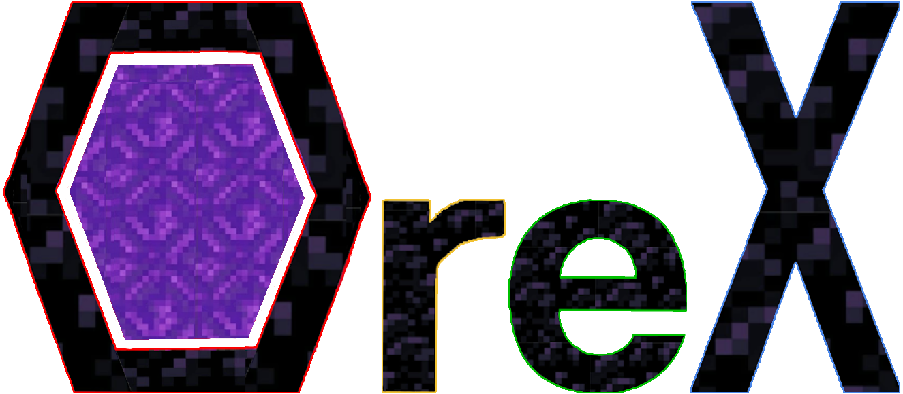

# OreX

A gamified stock market simulation with Minecraft-inspired ores, built with Python and Flask. Trade ores like stocks: buy low, sell high, and grow your fortune as prices move every 20 seconds alongside a cast of bot traders.


## Status

OreX is in active development. Features, balancing, and the database schema may change between versions.

## Features

- **9 tradeable ores**: Coal, Copper, Redstone, Iron, Lapis Lazuli, Gold, Emerald, Diamond, and Netherite, each with its own price range and volatility.
- **Live market**: Prices update every 20 seconds, driven by trends, support/resistance levels, player and bot influence, and rare market events that cause price shocks.
- **Trading**: Buy and sell with confirmation steps and atomic transactions. Standard mode caps each holding at 500 units.
- **Stop-loss and take-profit**: Set SL/TP levels on holdings and let the market engine close them automatically.
- **Advanced Mode**: An unlockable prestige layer (reach $100,000 net worth, then buy it for $50,000) that removes the holding cap and enables short selling with margin, collateral, tick fees, and squeeze prices.
- **Price charts**: Interactive ore charts with time range filters.
- **Dashboard, Portfolio and Finances**: Balance, top movers, holdings, profit/loss, capital breakdown, short exposure, and cash flow.
- **Leaderboard and public profiles**: Compete against other players and 9 bot traders, and view any player's public profile.
- **Daily login bonus**: A three-day bonus ladder to help new players get started.
- **Inbox and notifications**: Trade fills, SL/TP triggers, bonus reminders, and advancements arrive as toasts and inbox messages.
- **Advancements**: Minecraft-style achievements for trading milestones.
- **Interactive tutorials**: Guided tours for new players and for Advanced Mode.
- **Accounts**: Registration, login, avatars, password changes, account reset and deletion, and optional TOTP two-factor authentication with backup codes.
- **Live updates**: HTMX refreshes market prices, dashboard, portfolio, and leaderboard without page reloads.
- **Themes**: Light and dark themes, plus unlockable themes.

## Tech Stack

| Layer | Technology |
|-------|-----------|
| Backend | Python 3, Flask 3.1 |
| Database | SQLite3 (built-in) |
| Templating | Jinja2 |
| Auth | Flask-Login, Werkzeug password hashing, PyOTP (2FA) |
| CSRF | Flask-WTF |
| Frontend | HTML5, CSS3 (custom properties), vanilla JavaScript, HTMX, Alpine.js |
| Charts | ApexCharts |
| Testing | Pytest, Hypothesis |
| Security scanning | Bandit, pip-audit |
| Deployment | Gunicorn, Nginx, Docker Compose |

## Project Structure

```
OreX/
├── pyproject.toml           # Dependencies (runtime, dev, prod groups) and pytest config
├── uv.lock                  # Exact pinned versions, managed by uv
├── .python-version          # Python version uv uses locally
├── Dockerfile               # App image (Gunicorn, 1 worker)
├── docker-compose.yml       # Local Nginx -> Gunicorn -> SQLite stack
├── .env.example             # Environment variable template
├── docker/
│   └── nginx/               # Nginx image and config
├── src/
│   ├── run.py               # Development entry point
│   ├── schema.sql           # Database schema
│   ├── seed.sql             # Initial ore data
│   ├── app/
│   │   ├── __init__.py      # Flask app factory and security headers
│   │   ├── config.py        # Game and app configuration
│   │   ├── database.py      # SQLite connection and initialisation
│   │   ├── models.py        # Data access functions
│   │   ├── advanced.py      # Advanced Mode eligibility, purchase, and toggle
│   │   ├── advancements.py  # Achievement logic
│   │   ├── bonus.py         # Daily login bonus
│   │   ├── finances.py      # Finances page calculations
│   │   ├── totp.py          # Two-factor authentication
│   │   ├── routes/          # Flask blueprints (auth, market, trade, portfolio, etc.)
│   │   ├── market/          # Market engine (algorithm, bots, events, influence, levels, shorting)
│   │   ├── tutorial/        # Tutorial tracks and state
│   │   └── utils/           # Validation and formatting helpers
│   ├── templates/
│   │   ├── base.html        # Base template
│   │   ├── pages/           # Full page templates
│   │   └── partials/        # HTMX fragments and shared components
│   ├── static/              # CSS, JS, images, audio, tutorial data
│   └── data/                # SQLite database (auto-created)
├── migrations/              # Database migrations
├── scripts/                 # dev/ (screenshots, browser checks) and admin/ (production management: password reset, data export, rename, suspend, economy reset; see scripts/README.md)
├── tests/                   # Pytest test suite
└── docs/                    # Planning documents and assets
```

## Running Locally

### Prerequisites

- [uv](https://docs.astral.sh/uv/getting-started/installation/) (it installs the right Python version for you)

### Installation

1. Clone the repository:
   ```bash
   git clone https://github.com/Zechariah-Guo/OreX.git
   cd OreX
   ```

2. Create `.venv` and install the locked dependencies (including dev tools):
   ```bash
   uv sync
   ```

3. Run the application:
   ```bash
   cd src
   uv run python run.py
   ```

4. Open your browser and navigate to `http://127.0.0.1:4000`

The SQLite database is created and seeded with the 9 ores on first run. To reset it, stop the server, delete `src/data/orex.db`, and start the server again.

### Running with Docker

The Docker Compose setup runs the production stack locally (Nginx, Gunicorn with one worker, and SQLite):

1. Copy `.env.example` to `.env` and set `SECRET_KEY`. Set `SESSION_COOKIE_SECURE=0` when testing over plain http.
2. Run `docker compose up --build`.
3. Open `http://localhost:8080`.

The image includes `scripts/admin`, so admin tasks run inside the container, for example `docker compose exec app python /app/scripts/admin/reset_password.py <username> --random`.

### Running Tests

```bash
uv run pytest
```

Some 2FA property tests are slow because they hash many passwords. Skip them with `uv run pytest -m "not slow"`, and skip the real-browser tests with `-m "not browser"`.

### Safari-Engine Check (dev only)

`scripts/dev/safari_check.py` loads the main pages in Playwright's WebKit with iPhone and iPad presets, saves screenshots to `screenshots/safari/` and prints a pass/fail table. One-time setup: `uv sync` then `uv run playwright install webkit`. Run: `uv run python scripts/dev/safari_check.py` (add `--compare` to diff against Chrome). It is a WebKit port, not real Safari, so it cannot show safe-area insets, the iOS address bar or input zoom.

To hand-test in a visible WebKit window, start the dev server first (it must be running), then either:

```bash
uv run playwright open --browser webkit --device "iPhone 13" http://127.0.0.1:5000
```

(use `--viewport-size "360,800"` instead of `--device` for a custom size; `--save-storage screenshots/state.json` and `--load-storage screenshots/state.json` keep a login between runs. That file holds a session cookie, so keep it under the git-ignored `screenshots/`), or from Python:

```python
from playwright.sync_api import sync_playwright
with sync_playwright() as p:
    page = p.webkit.launch(headless=False).new_context(**p.devices["iPhone 13"]).new_page()
    page.goto("http://127.0.0.1:5000")
    page.pause()  # close the Inspector window to finish
```

Caveats: no Safari toolbar or address bar, safe-area insets are 0, and mouse input is turned into touch events.

### Managing Dependencies

| Task | Command |
|------|---------|
| Add a runtime dependency | `uv add <pkg>` |
| Add a dev-only dependency | `uv add --dev <pkg>` |
| Add a production-server dependency | `uv add --group prod <pkg>` |
| Remove a dependency | `uv remove <pkg>` |
| Upgrade one package | `uv lock --upgrade-package <pkg>` then `uv sync` |
| Security audit | `uv export --no-dev --no-hashes -o .kiro/tmp/req.txt` then `uv run pip-audit -r .kiro/tmp/req.txt` |

Commit both `pyproject.toml` and `uv.lock` after any change.

## Pages

| Route | Description |
|-------|-------------|
| `/` | Landing page with a live ore ticker |
| `/register`, `/login` | Account creation and sign-in, with a 2FA challenge when enabled |
| `/dashboard` | Balance, top movers, and recent activity |
| `/market` | All ores and their current prices |
| `/market/<ore_id>` | Ore detail with price chart and buy/sell/short forms |
| `/portfolio` | Holdings, short positions, and profit/loss |
| `/finances` | Capital breakdown, short exposure, and cash flow |
| `/history` | Paginated transaction history |
| `/leaderboard` | Rankings of players and bot traders |
| `/profile` | Your profile, avatar, and daily bonus |
| `/player/<username>` | Public player profiles |
| `/inbox` | Notifications |
| `/settings` | Password, 2FA, Advanced Mode, account reset and deletion |
| `/help` | Help and tutorial list |
| `/about` | About the project |

## Configuration

Game settings live in `src/app/config.py`. Key values:

| Setting | Default | Description |
|---------|---------|-------------|
| `DEFAULT_BALANCE` | `10000` | Starting balance for new players |
| `TICK_INTERVAL` | `20` | Seconds between market price updates |
| `MAX_BUY_QUANTITY` | `500` | Holding cap per ore in standard mode |
| `ADVANCED_MODE_THRESHOLD` | `100000` | Net worth required to unlock Advanced Mode |
| `ADVANCED_MODE_COST` | `50000` | Price of Advanced Mode |
| `BONUS_AMOUNTS` | `1000 / 10000 / 50000` | Daily bonus for days 1, 2, and 3 |

Deployment settings are read from environment variables. See [`.env.example`](.env.example) for `SECRET_KEY`, `OREX_TRUST_PROXY`, `SESSION_COOKIE_SECURE`, and avatar storage options.

**Web Push (optional).** Players can opt in to push notifications under Settings > Notifications (stop loss and take profit fills, liquidations, the daily bonus, achievements). A push is sent only when the player has had no visible OreX page open for about a minute; otherwise the normal in-app toast is used. Push is off until the server has VAPID keys: run `python scripts/admin/generate_vapid_keys.py` once, then set `VAPID_PUBLIC_KEY`, `VAPID_PRIVATE_KEY` and `VAPID_SUBJECT` (a `mailto:` or `https://` contact) in the environment or `.env`. Browsers require https (or localhost); on iPhone and iPad the site must be installed to the Home Screen first (iOS 16.4 or later).

## Security

- **Password hashing**: Passwords and 2FA backup codes are hashed with Werkzeug.
- **Two-factor authentication**: Optional TOTP with QR code setup and backup codes.
- **Password recovery**: An optional one-time recovery key (shown inside the registration form, which cannot be submitted until the user confirms they saved it; stored only as a hash, and only when the account is created) lets a user reset a forgotten password. The key travels in a signed, time-limited token, so nothing is stored before the form is submitted. The reset form offers a new key the same way (ticked by default) and the old key is consumed in the same transaction. It shares the login rate limiter. If a user has no key, an admin can run `python scripts/admin/reset_password.py <username>` (prompts for the new password; add `--random` to generate a temporary one). 2FA is not affected.
- **CSRF protection**: All forms are protected with Flask-WTF.
- **Rate limiting**: The login endpoint limits repeated attempts.
- **Parameterised queries**: All database access uses bound parameters to prevent SQL injection.
- **Security headers**: `Content-Security-Policy`, `X-Frame-Options`, `X-Content-Type-Options`, `Referrer-Policy`, and `Permissions-Policy` are set on every response.
- **Session cookies**: `HttpOnly`, `SameSite=Lax`, and `Secure` in production.
- **Secret key enforcement**: The app refuses to start in production without a `SECRET_KEY`.

## Licence

This project is available under the MIT licence. See [LICENSE](LICENSE).
